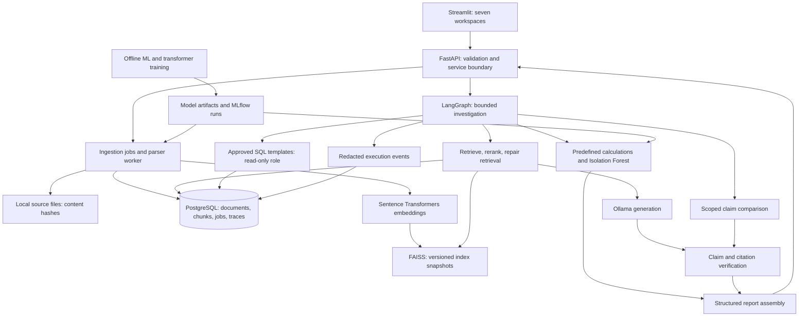

# NexusAI — Phase 1 engineering specification

Date: 13 October 2026. Status: architecture and acceptance criteria only. No application, trained model, benchmark, screenshot, or deployment is claimed complete.

## 1. Feasibility and product boundary

Build a local, single-user, English-language business intelligence application around one fictional company and one defined sales schema. The complete requested project is feasible as a staged portfolio product. General enterprise deployment adds authentication, authorization, tenancy, retention, audit controls, operational monitoring, and load testing beyond this first release.

Primary demonstration: “Why did revenue decline in September 2025 compared with August 2025?” The application calculates the change, decomposes it by product/region, checks unusual patterns, retrieves relevant business notes, exposes conflicting statements, and distinguishes measured contributions from possible explanations. A revenue contribution is an arithmetic decomposition, not proof of causation.

Initial boundaries: selectable dataset and dates; text-based PDFs, DOCX, TXT and schema-validated CSV; policy conflicts involving quantities, dates, and explicit negation; bounded tool workflows; local storage. Scanned PDFs report OCR-required rather than silently producing empty results. No arbitrary Python execution, autonomous writes, unrestricted SQL, web research agent, or automatic authority inference from document content.

The MVP includes a narrow version of all five flagship capabilities. ML and transformer training remain required later milestones; their omission from the first usable slice does not remove them from the full project.

Main risks: reliable claim-to-evidence alignment; incomplete PDF/table extraction; temporal/entity ambiguity in contradictions; read-only database access; memory pressure from concurrent models; small or templated classification data; cross-store consistency between SQL and FAISS; model and dependency reproducibility.

## 2. Architecture decisions

Use a modular monolith: one FastAPI backend, one Streamlit client, PostgreSQL, and a local FAISS index. A separate local ingestion worker consumes a durable SQL job table once ingestion becomes asynchronous. Services share typed internal contracts rather than communicating through extra microservices. Training runs separately from serving.

PostgreSQL is the default from Phase 2. SQLite is permitted only for fast isolated unit tests; it cannot validate PostgreSQL permissions or replace database integration tests. FAISS holds vectors, not source-of-truth metadata. Rebuild it from persisted chunks and the recorded embedding revision.

Begin with normalized embeddings and exact inner-product search. Within the initial corpus limit, construct/search the allowed document subset when metadata filters apply. Do not retrieve a global top-k and assume post-filtering preserves recall. Later optimize with partitioned indexes or a filtered vector database when measured scale warrants it.

Only READY document/index generations are searchable. Write a new immutable index snapshot, verify IDs and checksum, then publish its manifest transactionally in SQL. Readers keep their generation pinned; a crash can leave an unused file but never a published partial snapshot. One writer holds the indexing lock. Deletions must remove searchable membership immediately and trigger rebuild.

## 3. Stack and hardware policy

| Component | Selection | Purpose |
|---|---|---|
| Runtime | Python 3.11, uv, pyproject.toml and lockfile | Repeatable environment; versions resolved and tested in Phase 2 |
| API | FastAPI, Pydantic, Uvicorn, pydantic-settings | Validated APIs and environment configuration |
| Persistence | PostgreSQL 17, SQLAlchemy 2, Alembic, psycopg | Data, migrations, explicit role separation |
| UI | Streamlit, Plotly | Document, evidence, table, chart and trace views |
| Extraction | pypdf, python-docx, Python CSV parser | Local format adapters with resource limits |
| Retrieval | sentence-transformers/all-MiniLM-L6-v2; faiss-cpu | Initial English semantic retrieval |
| Reranking | cross-encoder/ms-marco-MiniLM-L6-v2 | Joint query/passage relevance scoring |
| LLM | Ollama qwen3:4b-instruct, quantized | Local generation and constrained planning |
| Workflow | LangGraph; direct service calls | Explicit state, branching and termination |
| Numerical analysis | pandas, NumPy, scikit-learn | Aggregations, baseline models and Isolation Forest |
| DL | PyTorch, Hugging Face Transformers; DistilBERT | Actual supervised encoder fine-tuning |
| Experiments | MLflow local tracking | Parameters, artifacts, splits and actual results |
| Testing | pytest, HTTPX, Ruff | Unit, integration, API and style checks |
| Deployment | Docker Compose | API, UI and PostgreSQL; native host Ollama on macOS |

LangChain wrappers and XGBoost are not needed initially. A provider adapter will support an optional external API, explicitly enabled with configured credentials; private documents never leave the machine by automatic fallback. Model downloads require internet once; runtime is local after assets are cached.

Observed environment: arm64; user confirmed 16 GB unified memory. Automatic RAM detection was denied by the sandbox. Begin with a 4-bit 4B model, 4,096-token total context, single concurrent generation, and small embedding batches. The Ollama model download is approximately 2.5 GB, which is not its total runtime RAM requirement. Reduce model size or context if actual memory pressure requires it. Do not promise tokens/sec before measuring.

Run transformer training on native macOS using MPS when available, CPU otherwise. Start with sequence length 256 and batch size 4, then tune from measured memory use. Stop/unload Ollama during training. Docker on macOS uses Linux CPU execution; do not assume it exposes the Mac GPU. Native model serving and containerized application services are the initial deployment topology.

## 4. Data and service contracts

Persist documents (UUID, SHA-256, filename, media type, upload time, parser version, processing state), document versions (family, issuer, authority scope, approval status, version, effective interval, supersedes relation), chunks (UUID, document version, text offsets, page/paragraph/row locator, content hash), datasets, ingestion jobs, index generations, model runs, investigations, and trace events.

Source authority metadata is an operator-curated assertion with provenance. Extracted metadata is a separate untrusted proposal until reviewed. The classifier predicts document type only; it never grants authority or suppresses retrieval.

Initial CSV schema: date, product, region, orders, units, revenue, expenses, currency. One row per date/product/region/currency. Validate duplicate keys, types, missing periods, negative values under a documented returns policy, and currency consistency. Do not sum different currencies. Store money as decimal/numeric or minor units, not binary floating point. Preserve source row IDs and file hash for each dataset version.

An answer returns answer text; an overall evidence status; factual claims with their own statuses; verified citations; missing information; unresolved conflicts; and trace ID. A citation contains document UUID, immutable version, chunk UUID, locator, and a quote validated against source text. A computed claim references a calculation ID with dataset hash, approved query/template, parameters, units, and result.

API surface: POST /documents/upload; GET /documents; GET /jobs/{id}; POST /datasets/upload; GET /datasets; POST /rag/query; POST /agents/investigate; POST /contradictions/analyze; POST /ml/anomaly-detect; POST /dl/classify; GET /evaluation/metrics; GET /traces/{id}; GET /health.

Upload returns a job ID for asynchronous processing. Required error cases: 413 oversized file, 415 unsupported media, 422 invalid data, 404 missing identifier, 503 missing model dependency. Evaluation returns “not run” with no numerical metrics until a recorded run exists. Errors include a request ID and safe message, not internal paths or credentials.

## 5. RAG and evidence reliability

1. Parse and normalize text while retaining original source locators. Detect headings and preserve tables as structured rows where extraction supports them. Use token-aware chunks within the embedding model's actual sequence limit; do not silently truncate oversized chunks.
2. Resolve dataset/document filters and temporal scope. Ask for clarification when materially ambiguous.
3. Retrieve top 20 initial candidates; rerank to up to 5 passages. These are starting configuration values, not validated optima.
4. Evaluate coverage of query entities, required fields and dates, plus relevance scores. Tune thresholds on a development set; raw cosine/reranker scores are not confidence probabilities.
5. If coverage is inadequate, reformulate while preserving original intent and filters. Allow at most two additional retrieval attempts, deduplicate evidence, and stop if coverage does not improve.
6. Generate structured atomic claims and evidence references. Keep retrieved material in a clearly delimited untrusted data field, never in privileged instructions. Documents cannot choose tools or grant permissions.
7. Validate cited IDs, quote spans, factual units/dates/entities, and calculation lineage. Exact quotations can be checked deterministically; valid citation syntax alone does not prove semantic support.
8. For paraphrases, use a separate entailment model or adjudicated semantic-check path validated against labeled claim/evidence pairs. Treat this as a fallible classifier, not an oracle. Until validated, fall back to verified extractive responses or mark unsupported/partial. Choose its model in Phase 5 after resource, license and domain evaluation.
9. Allow one constrained answer repair to remove unsupported claims or replace them with verified extracts. Recheck it. If still unsupported, abstain or return only verified claims. The generator never awards itself a success score.

Status rules: SUPPORTED means every material factual claim has verified support and no unresolved relevant conflict; PARTIALLY SUPPORTED means some material claims are supported while remaining gaps are explicit; UNSUPPORTED means no adequate material support; CONFLICTING EVIDENCE means comparable admissible sources disagree and authority cannot resolve them. Preserve claim-level outcomes so a single summary does not hide mixed evidence.

No percentages appear as confidence. Model scores can appear as labeled retrieval diagnostics. Supporting evidence demonstrates what a source states, not that the source is true in the world.

## 6. Contradictions and authority

Represent extracted claims with subject, predicate/metric, value, unit, currency, population, location, effective interval, negation/modality and exact source span. Compare across different documents only after scope normalization. Candidate extraction may use the LLM but every retained field must align to source spans or verified metadata.

Example: 20 annual leave days versus 25 for the same employee population and overlapping effective period is a possible conflict. Days versus hours, different countries, or non-overlapping policy periods must not be treated as the same claim automatically.

Authority resolution requires a configured rule: an approved policy owner, applicable effective dates, and an explicit supersedes chain within the same policy family. A recent upload, persuasive wording, or a higher extracted version string alone is insufficient. Missing or inconsistent metadata yields an unresolved conflict. Even resolved discrepancies retain both source passages and the rule used.

Start with numeric/date/polarity claims. General legal interpretation and arbitrary prose contradictions remain explicitly limited.

## 7. Controlled investigation and security

State: objective, dataset version, date range, permitted tools, plan, remaining budget, evidence, calculations, conflicts, findings, failures and trace ID. Planner proposes typed tool calls; deterministic validation admits only supported names and arguments.

Tools: document_search, read_only_sql, business_analyzer, anomaly_detection, contradiction_finder, report_generator. Route by validated intent and available data. Missing dataset or date scope produces a clarification request, not a guessed answer.

Initial budgets: 12 tool calls, 24 graph super-steps, 180 seconds end-to-end, 5 seconds SQL statement timeout, 60 seconds generation timeout, and one retry for transient tool errors. Retrieval retries remain inside the global budget. Enforce wall-clock cancellation and subprocess isolation where a native/model operation cannot be interrupted safely. LangGraph recursion limits alone do not enforce wall-clock time or nested retries.

SQL tool accepts an approved template ID and typed parameters. No public arbitrary SQL endpoint. A separate non-owner PostgreSQL login has SELECT only on approved analytics relations, no role inheritance to writers, no schema create rights, and read-only transactions. Restrict callable functions/search paths and connection options; use parameter binding and row caps. Migration and ingestion writer connections are never available to the agent. Test permission enforcement directly, including writes/DDL/unsafe functions, not only an input validator. PostgreSQL read-only mode alone is not a complete sandbox.

Numerical tools execute predefined functions only. Reports link each number to a calculation record. A tool error makes the report incomplete and visible; missing model artifacts cannot be replaced with invented predictions.

Trace events record tool name, sanitized parameters, template ID, evidence IDs/scores, concise routing reason, retries, verification outcome, duration and error category. Raw credentials, prompts containing private data, full query results and private reasoning are excluded by default. Query text is user content with retention controls; redact likely secrets and bind local services to localhost. Audit summaries are not chain-of-thought.

Uploads need byte/page/row limits, MIME/content checks, path isolation, archive expansion limits for DOCX, and isolated parsing with timeouts. Treat prompt-injection resistance as a tested defense-in-depth property, never a guarantee. Internet exposure requires additional authentication, authorization, TLS, upload hardening and operational controls.

## 8. Dataset plan and leakage controls

All following counts are collection targets, not existing assets or measured results.

| Dataset | Initial target | Ground truth and split |
|---|---|---|
| Business corpus | 40–60 original fictional-company files | Manifest with author, license, authority/effective metadata, expected claims and locators |
| RAG benchmark | 120 cases: 40 answerable, 20 unanswerable, 20 conflicting, 20 ambiguous, 20 injection | Gold evidence spans, expected status, required facts and prohibited behavior; 60 development/60 sealed test grouped by source family |
| Business tasks | 20 investigations | Checked reference calculations, required tools and expected limitations |
| Metric history | 24 months daily across products/regions | Seeded synthetic seasonality and documented injected anomalies; chronological train/validation/test with distinct injected scenarios |
| Classification | 600–1,200 independent documents across six requested labels | Source/template-family grouped train/validation/test, approximately 70/15/15; license and provenance recorded |
| Claim verification/contradiction | At least 100 labeled evidence pairs | Include wrong scope, unit conversion, negation, authority ambiguity and dated revisions; group related claims together |

Do not inflate sample size by counting chunks or trivial template variants as independent documents. Keep all chunks, related versions and paraphrases from a source family in one partition. Freeze benchmark labels and hashes before model tuning. Retrieval test sources may be indexed at test time; their labeled questions and answers may not be used for tuning.

Use original synthetic data to establish pipeline correctness, explicitly labeled everywhere. Seek permitted public documents for an independent classification/domain evaluation and audit licenses before downloading or redistribution. No claim of real-world model generalization from synthetic tests. A second independent reviewer should adjudicate a sample of semantic labels; a single-reviewer limitation must be disclosed if that is unavailable.

## 9. ML and deep learning implementation plans

Isolation Forest: aggregate validated daily metrics; engineer trailing-only lags, shifted rolling medians/deviations, changes and calendar features; fit preprocessing on training data; compare against seasonal/robust statistical baseline. Choose the alert threshold on validation data or a declared alert budget. Report held-out precision, recall, F1 and PR-AUC only when labels exist, and also false alerts per period. Separate event-level from row-level detection. Synthetic labels evaluate injected scenarios, not business anomaly truth. Serialize trusted locally produced artifacts with feature schema, versions, seed and training cutoff; never load user-provided pickle/joblib files.

Document classifier: train TF-IDF plus logistic regression first. Fine-tune DistilBERT encoder weights and classification head using the identical grouped split. Tokenize with explicit truncation/window policy; aggregate windows at document level so long files are not dominated by their first paragraph. Select the checkpoint using validation macro-F1. Report test accuracy, macro precision/recall/F1, per-class support and confusion matrix for both models. Save tokenizer, weights, label mapping and manifest. Reload the checkpoint in a separate process and test inference parity. Predicted labels aid browsing; user corrections remain possible. If the baseline wins, report that result rather than hiding it.

## 10. Evaluation and release gates

Retrieval: Recall@5 = relevant units retrieved / all annotated relevant units; Precision@5 = relevant units / five returned slots (missing slots count as empty); MRR@10 = reciprocal rank of the first relevant unit, or zero. Define gold units as evidence spans and map overlapping chunks to them without double counting. Report per question and by question category. Unanswerable cases are scored for abstention rather than retrieval recall.

Answers: required-fact correctness; proportion of factual claims actually supported; citation-reference validity; citation support precision; citation coverage of factual claims; correct abstention and false-abstention rates. A human-labeled sample audits automatic verification. Show sample sizes and uncertainty intervals where useful, and never label an LLM judge alone as ground truth.

Conflicts: pair-level precision/recall/F1; scope mismatch false positives; correct authority resolution rate; unresolved-conflict rate. Agents: task success against expected numerical results/evidence/constraints; tool argument validity; SQL policy violations; timeout/budget compliance. Performance: measured p50/p95 latency, cold/warm runs, peak memory, concurrency, hardware and model revision. Small-sample tail latency is explicitly provisional.

Compare retrieval only vs reranking vs bounded retry, and answer verification disabled/enabled. Tune only on development data. Do not assert that additional components improve quality before comparing held-out results.

Hard release invariants: every emitted citation resolves to the exact stored source/version; no tested unauthorized SQL operation succeeds; global budgets terminate all tested workflows; uninstalled models report unavailable; numerical assertions retain calculation lineage; test reports distinguish mocked/unit runs from downloaded-model integration runs. Statistical quality targets will be set from the Phase 4 baseline and frozen before held-out evaluation. There are currently no benchmark results.

## 11. Roadmap with validation gates

| Phase | Deliverable | Gate before proceeding |
|---|---|---|
| 1 | This specification | Scope, contracts, failure modes, datasets and gates documented; assumptions marked |
| 2 | Repository, environment, migrations, health endpoint, CI | Clean install on arm64, API smoke test, PostgreSQL role tests, lockfile produced |
| 3 | Four-format ingestion and FAISS persistence | Fixtures extract expected spans; duplicate/corrupt/oversized files handled; restart and filtered retrieval tests pass |
| 4 | Local RAG with immutable citations | Real embedding and LLM smoke runs; source offsets verified; baseline evaluation saved |
| 5 | Retry and evidence verification | Unsupported claims, fake citations, insufficiency and injection regression suite; verifier measured on labeled pairs |
| 6 | Scoped contradictions and authority | 20/25/22-day conflict, scope/date negatives and explicit supersession tests pass |
| 7 | Six-tool LangGraph investigation | Reference calculations match; prohibited SQL fails at DB; tool failures, cancellation and budget tests pass |
| 8 | Trained anomaly subsystem | Chronological evaluation, baseline comparison, serialized-model reload and API inference verified |
| 9 | Fine-tuned transformer | Grouped held-out results vs baseline, real checkpoint reload and ingestion integration verified |
| 10 | Seven-section Streamlit UI | Real browser end-to-end walkthrough, missing-model states, real screenshots and trace navigation verified |
| 11 | Full evaluation and optimization | Reproducible reports, held-out results, regression and measured performance recorded |
| 12 | Docker and portfolio documentation | Fresh-checkout setup and Compose smoke run; README, demo, interview guide and evidence-based resume bullets |

Estimated focused effort for a student learning implementation: 220–350 hours total. Approximate allocation: architecture/setup 20–30; ingestion/RAG/verification 50–75; contradictions/agent 40–65; datasets/ML/DL 55–90; UI/testing/docs/deployment 55–90. These allocations sum to 220–350 hours. At 15–20 hours/week, budget roughly 11–24 weeks. A first useful RAG vertical slice may take 35–60 hours. These are planning estimates, not delivery promises; corpus labeling is the largest uncertainty.

## 12. Teaching and interview framework

| Component | Internal mechanism and rationale | Alternative, common mistake, interview explanation |
|---|---|---|
| Ingestion | Stable source spans survive text normalization | OCR/layout parser later; losing page/table provenance breaks citations; explain immutable lineage |
| Retrieval | Fast independent embeddings shortlist passages; a cross-encoder jointly scores query/passage pairs | BM25 or vector DB; similarity is not factual support; explain the recall/precision/cost tradeoff |
| Verification | Check references, exact spans, typed facts and semantic entailment separately | Human review or extractive answers; self-rating is circular; explain conservative abstention and measured error rates |
| Contradictions | Compare normalized claims under matching scope and approved authority rules | General NLI; dates alone do not settle policy; explain unresolved evidence explicitly |
| Agent | A graph routes validated state among bounded tools | Fixed pipeline; unrestricted autonomy multiplies failure paths; explain why constrained plans are still agentic |
| SQL/data | Database permissions plus approved parameterized queries and checked calculations | Query AST validation later; SELECT text is not sufficient security; explain defense in depth |
| Anomaly ML | Isolation Forest ranks unusual feature combinations | Robust seasonal baseline; fitting on future data leaks; explain alert budgets and chronological validation |
| Transformer DL | Fine-tuning updates encoder weights for document labels | TF-IDF baseline; template leakage inflates scores; explain grouped splits and honest baseline comparison |
| Operations | Model/data manifests, migrations, immutable indexes and trace events support reproduction | Managed platforms later; an experiment screenshot is not reproducibility; explain rebuilding a result from IDs |

Each implementation phase will add a short walkthrough covering inputs/outputs, key code paths, tests, alternatives, failure modes and an interview explanation. Resume bullets are written only after actual implementation and measurement.

## 13. Phase 1 review and outstanding checks

Design review completed against all five flagship features, the twelve phases, security boundaries, and required ML/DL lifecycles. This is a requirements/architecture review, not execution validation. User confirmed 16 GB RAM. Remaining checks belong to their phase gates: package compatibility, native model memory/latency, source dataset licensing/availability, and verifier suitability. No software or model was installed or trained during Phase 1.

## Official references consulted

- [Sentence Transformers retrieve and rerank](https://sbert.net/examples/sentence_transformer/applications/retrieve_rerank/README.html): distinction between initial retrieval and joint reranking.
- [LangGraph graph API and recursion limits](https://github.com/langchain-ai/docs/blob/main/src/oss/langgraph/graph-api.mdx): explicit graph state and execution limit configuration.
- [Ollama Qwen3 4B instruct model](https://ollama.com/library/qwen3:4b-instruct): available quantized local model artifact.
- [PyTorch MPS backend](https://docs.pytorch.org/docs/main/notes/mps.html): native macOS device availability checks.
- [DistilBERT model card](https://huggingface.co/distilbert/distilbert-base-uncased): pretrained encoder and downstream fine-tuning basis.
- [PostgreSQL transaction modes](https://www.postgresql.org/docs/current/sql-set-transaction.html): database read-only transaction semantics and limitations.
- [FAISS getting started](https://github.com/facebookresearch/faiss/wiki/Getting-started): exact flat vector index design.
