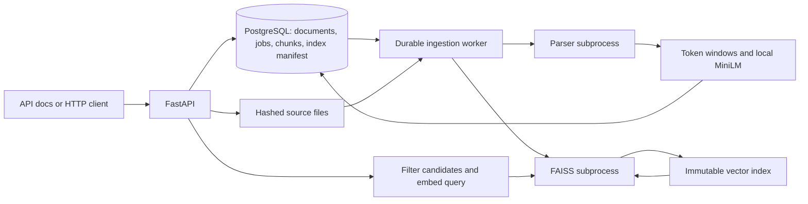

# NexusAI — Evidence Intelligence

A local-first business intelligence and evidence-verification platform, built incrementally for a 16 GB Apple Silicon laptop.

**Implemented: phases 1–3 — architecture, backend foundation, document ingestion and semantic indexing.** Upload PDF, DOCX, TXT or CSV files; follow durable ingestion jobs; search local embeddings; inspect source locations and chunk offsets. **65 automated tests passed locally**, including real PostgreSQL, downloaded-model, FAISS and live HTTP-server checks. See [Phase 3 validation](docs/PHASE-3-VALIDATION.md).

RAG answer generation, evidence verification, contradiction detection, analytical agents, trained anomaly/classification models and Streamlit are planned phases, not completed features. This repository does not claim production deployment or model-quality benchmarks.

## Problem and engineering approach

Business answers need traceable sources and reproducible calculations. NexusAI starts by making the evidence layer inspectable: immutable source hashes, token-aware chunks, durable jobs and atomically published index generations. Later phases will build and evaluate grounded answers and controlled investigations on this foundation.

Current differentiators:

- Source locators and exact offsets into stored extracted blocks.
- Content-based duplicate detection with explicit job status and bounded retries.
- PostgreSQL-backed recovery after a worker interruption.
- Exact FAISS search with metadata filtering before ranking.
- Immutable, checksum-validated index snapshots rebuildable from persisted vectors.
- Isolated parsing and FAISS processes with timeouts; FAISS isolation resolves an observed Apple Silicon native-runtime conflict.
- Actual failed experiments and limitations recorded in the [engineering log](docs/TROUBLESHOOTING.md).

## Architecture



The [full architecture specification](ARCHITECTURE.md) describes later phases. The [Phase 3 walkthrough](docs/phase-3.md) explains implementation internals, tradeoffs, failure modes and an interview explanation.

## Stack

| Purpose | Technology |
|---|---|
| Runtime and dependency locking | Python 3.11, uv |
| API and configuration | FastAPI, Pydantic, Uvicorn |
| Database and migrations | PostgreSQL 17.11, SQLAlchemy, Alembic, psycopg |
| Parsing | pypdf, python-docx, standard CSV/text parsing |
| Embeddings | Sentence Transformers, PyTorch, pinned all-MiniLM-L6-v2 |
| Vector search | FAISS exact inner-product index, NumPy |
| Validation | pytest, HTTPX2, Ruff, real PostgreSQL and model tests |

Model inference is local CPU inference in this phase. There is no paid API requirement. Linux selects the official CPU PyTorch package index; macOS uses native wheels. Model training and MPS tuning are later work.

## Requirements and first setup

Use macOS Apple Silicon or Linux, [uv](https://docs.astral.sh/uv/getting-started/installation/) and a running Docker engine. Initial downloads need internet. Run commands from the repository root. uv 0.13.0 and Python 3.11.17 were used for the local validation.

```sh
uv sync --locked
uv run python scripts/configure_local.py
docker compose up -d --wait db
uv run python scripts/bootstrap_database.py
uv run alembic upgrade head
uv run python scripts/download_embedding_model.py
```

`configure_local.py` creates unique credentials in a private `.env` and refuses to overwrite existing configuration. The default database port is 55432; set `NEXUS_DB_PORT` before configuration to choose another. `.env.example` documents variables but contains no usable passwords. Do not overwrite generated credentials with the example.

`NEXUS_DATA_DIR` defaults to `data`; `NEXUS_MODEL_DIR` defaults to `artifacts/embedding`. Use the same configuration and working directory for API and worker. Local sources, models, index files, caches, credentials and environments are excluded from Git.

The model download script pins revision `1110a243fdf4706b3f48f1d95db1a4f5529b4d41` and records checksums. Runtime inference never downloads missing models. Missing/invalid artifacts produce explicit failures. Do not change the model without rebuilding compatible embeddings and indexes.

## Run

Terminal 1:

```sh
HF_HUB_OFFLINE=1 uv run uvicorn nexusai.main:app --host 127.0.0.1 --port 8000 --no-access-log
```

Terminal 2:

```sh
HF_HUB_OFFLINE=1 uv run python -m nexusai.documents.worker
```

Open [interactive API documentation](http://127.0.0.1:8000/docs). Upload a file, poll its returned job ID, then search when the job succeeds. There is no Streamlit frontend yet.

On the already-configured development machine, `.venv/bin/python` and `.venv/bin/uvicorn` also work when uv is not on the shell PATH. Apply `alembic upgrade head` and restart the API/worker after updating code.

## API

| Method and route | Behavior |
|---|---|
| `GET /health/live` | Process liveness |
| `GET /health` or `/health/ready` | Database connectivity and schema revision; 503 when unavailable |
| `POST /documents/upload` | Multipart `file` and optional manual `category`; returns 202 with document/job IDs |
| `GET /documents` | Document status, format, hash, timestamp and chunk count; paginated |
| `GET /jobs/{job_id}` | Processing state, attempts and safe failure code |
| `POST /jobs/{job_id}/retry` | Requeue eligible failed jobs, up to three total attempts |
| `GET /documents/{document_id}/chunks` | Paginated source excerpts, block offsets and text hashes |
| `POST /documents/search` | Query, k, optional document IDs/category; ranked evidence, not generated answers |
| `GET /index/status` | Published generation, chunk count and embedding signature |

Example search body:

```json
{"query":"How many annual leave days?","k":5,"category":"hr_policy"}
```

Readiness checks the database/schema; it does not promise a running worker or downloaded model. Similarity scores are raw ranking diagnostics, not confidence percentages.

## Demo and measured limitations

With both services running:

```sh
uv run python scripts/demo_documents.py --output docs/phase-3-demo.json
```

The demo uploads three [synthetic sample files](datasets/samples/README.md), polls real jobs, searches and verifies returned text against stored chunks. [Recorded results](docs/phase-3-demo.json) show expected evidence at ranks **1, 1 and 2**. September's CSV row ranked second behind August for a month-name query against numeric dates. This is a known dense-retrieval limitation; recording top-5 evidence does not fix the top-1 error.

These are narrow smoke checks, not a retrieval benchmark, accuracy estimate, financial analysis or proof of answer faithfulness. A held-out evaluation suite is part of later phases. No fabricated screenshots are included; the current interface is the actual API documentation.

## Tests

```sh
uv run ruff check .
uv run ruff format --check .
uv run pytest -q -m 'not integration'
NEXUS_RUN_DB_TESTS=1 NEXUS_RUN_MODEL_TESTS=1 HF_HUB_OFFLINE=1 uv run pytest -q
```

Without the opt-in flags, database/model tests are skipped; skipped tests are not passes. Foundation permission tests use temporary probe tables. Document/model tests create and remove a uniquely named disposable database using the local bootstrap administrator; they do not mix test documents into the application corpus. Never configure these commands against an unrelated or shared production cluster.

[JUnit results](docs/phase-3-tests.xml) and the [validation report](docs/PHASE-3-VALIDATION.md) record actual local evidence. GitHub Actions is configured to download the pinned model, disable model networking during tests, and run the suite. A configured workflow is not proof of a successful remote run.

## Recovery and local lifecycle

```sh
uv run python -m nexusai.documents.worker --once
uv run python -m nexusai.documents.worker --rebuild-index
docker compose stop db
docker compose start db
```

A rebuild uses persisted vectors and writes a new index generation. Do not delete the database volume to diagnose ordinary failures. Back up PostgreSQL and `data/` together; old snapshots and failed source files currently require a deliberate retention procedure. Changing `.env` alone does not rotate initialized PostgreSQL passwords.

Use the [troubleshooting log](docs/TROUBLESHOOTING.md) for prior failures and fixes. In particular, do not import FAISS into the model/API process or enable unsafe OpenMP duplicate-runtime overrides.

## Scope and limits

Local single-user application only: no authentication, multi-tenancy or public deployment. Parser isolation is not a hardened OS sandbox. Files are limited to 5 MiB; scanned/encrypted PDFs and some complex layouts require explicit review. UTF-8 and comma-delimited CSV are required. DOCX extraction covers body paragraphs/top-level tables, not every Word feature. The corpus is capped at 200 documents and 10,000 chunks. See the [full limitations](docs/phase-3.md).

Analytics roles are tested for least privilege; safe query templates and agent controls remain future work. Structured CSV analytics, document authority, reranking, evidence verification and trained ML/DL models are not implemented. No model training is claimed for using pretrained embeddings. No repository license has been selected yet.

## Roadmap

Phases 1–3 are locally validated. Next: Phase 4 basic RAG with resolvable citations; Phase 5 bounded retrieval correction and evidence verification; Phase 6 contradictions; Phase 7 analytical agents; Phases 8–9 ML/DL training; Phase 10 Streamlit; Phase 11 held-out evaluation; Phase 12 full deployment and portfolio documentation. Every phase has an acceptance gate in the architecture document.
