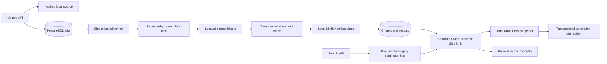

# Phase 3: document ingestion and semantic indexing

Implemented and locally validated on 14 October 2026. This phase retrieves evidence; it does not generate answers or establish factual support.

## End-to-end flow

1. `POST /documents/upload` accepts one PDF, DOCX, UTF-8 TXT or comma-delimited CSV. The request body is capped before multipart parsing; filename, media type, bytes and format signatures are checked.
2. Content is hashed, written under a generated identifier, and recorded with a durable SQL ingestion job. Identical content and extension reuse the existing document/job; metadata is not silently overwritten on a duplicate upload.
3. The separate worker acquires a PostgreSQL advisory lock. Only one worker may process/publish at once. It claims a queued job and marks it running before expensive work.
4. A short-lived parser process extracts source blocks. Every block records its location: PDF page, DOCX paragraph/table row, TXT paragraph, or CSV logical record.
5. The pinned MiniLM tokenizer creates windows of up to 224 content tokens with 32-token overlap. The actual model limit is checked before encoding. Offsets point into stored, normalized extracted blocks, not original PDF byte positions.
6. Sentence Transformers computes normalized, 384-dimensional embeddings locally on CPU. Model files are downloaded explicitly, checked against a revision manifest, and never fetched automatically by the API/worker.
7. Chunks, extracted blocks and vector bytes enter a SQL transaction. FAISS builds an exact inner-product index in a separate, bounded process. The new immutable file is written and flushed before SQL publishes its generation pointer and marks the document/job successful.
8. Search validates the stored index checksum, restricts the candidate set by document/category, then ranks that subset. Responses contain source identifiers, locations, offsets, text, source hash and a raw similarity score.



## Why these choices matter

**Source lineage:** a source filename alone is not a citation. The stored UUID, SHA-256, location and offset pair let later verification resolve the exact evidence. CSV rows are rendered as `column: value`; these are canonical extracted blocks, not byte-exact copies of CSV syntax. PDF reading order and table layout remain limited by extraction quality.

**Token-aware chunking:** character-based windows can silently exceed an embedding model's input length. Token offsets retain the original extracted text while respecting model capacity. Chunk overlap protects facts near window boundaries, at the cost of duplicate evidence that later evaluation must deduplicate.

**Exact FAISS search:** normalized-vector inner products correspond to cosine similarity. At the initial 10,000-chunk limit, exact search is understandable and avoids approximate-index tuning. The score is a ranking diagnostic, not probability or evidence confidence. BM25 and hybrid retrieval are useful later alternatives for exact names, dates and identifiers.

**Durable jobs:** an in-process FastAPI background task can disappear when its server exits. SQL state persists; a new worker can requeue abandoned running jobs after obtaining the exclusive lock. Three total processing attempts cap retries. Terminal failures retain a safe error code and require an explicit retry request when eligible.

**Atomic publication:** files and PostgreSQL cannot share a transaction. Writing an immutable snapshot first and changing the SQL pointer last ensures readers never see a partially written snapshot. A crash may leave an unreferenced file. This phase retains old snapshots; garbage collection and retention policy are future work.

**Process separation:** importing PyTorch and FAISS together caused native OpenMP crashes on this Mac. Import order initially passed tests but failed under the real HTTP server. The final design runs FAISS in subprocesses, caps concurrent native operations at two, and converts failures/timeouts into HTTP 503 responses. This costs process-startup time; it provides a clear failure boundary. Never enable `KMP_DUPLICATE_LIB_OK` to hide this conflict.

## Operational commands

From the repository root, after database setup and migrations:

```sh
uv run python scripts/download_embedding_model.py
HF_HUB_OFFLINE=1 uv run uvicorn nexusai.main:app --host 127.0.0.1 --port 8000 --no-access-log
```

In a second terminal:

```sh
HF_HUB_OFFLINE=1 uv run python -m nexusai.documents.worker
```

Run `--once` to process at most one queued job, or `--rebuild-index` to create a new snapshot from persisted vectors. A corrupt index is rejected until rebuilt; there is no silent fallback to fake vectors. For this already-configured workspace, `.venv/bin/python` and `.venv/bin/uvicorn` can replace `uv run python` and `uv run uvicorn` if uv is not on PATH.

```sh
uv run python scripts/demo_documents.py --output docs/phase-3-demo.json
NEXUS_RUN_DB_TESTS=1 NEXUS_RUN_MODEL_TESTS=1 HF_HUB_OFFLINE=1 uv run pytest -q
```

The demo needs both API and worker. It uses only committed synthetic files, polls each job, retrieves up to five hits within a selected document/category, and verifies the returned quote against the chunk endpoint. It records the expected evidence's actual rank rather than assuming the first hit is correct. It is a smoke check, not a representative retrieval benchmark.

## Current limits

- Single-user localhost service; no authentication or multi-tenant authorization.
- 5 MiB file, 6 MiB full request, 100 PDF pages, 20 MiB DOCX expanded archive, 2 million extracted characters, 2,000 chunks/document, 200 documents and 10,000 searchable chunks.
- Parser and FAISS operations have 20-second subprocess limits. Model encoding is bounded by input/batch limits but does not yet have a process-enforced wall-clock deadline.
- Parser subprocesses provide timeout/failure separation, not a hardened operating-system sandbox or strict memory quota. Public untrusted uploads need further isolation.
- Encrypted PDFs and PDFs with textless pages are rejected explicitly. A blank page may trigger the same review requirement as a scanned page. No OCR is claimed.
- DOCX body paragraphs and top-level table rows are supported. Headers, footers, text boxes, tracked changes and embedded objects are not comprehensively extracted; nested tables are rejected.
- CSV ingestion is textual retrieval only. Typed financial validation, database analytics and calculations arrive later. Non-UTF-8 inputs require conversion; no encoding is guessed.
- Category is user-provided metadata, not a classifier prediction or authority assertion.
- No deletion/retention UI yet. Source files, failed-job files and old snapshots persist locally.
- Temporal matching is not reliable from dense similarity alone. In the sample run, September's ISO-date CSV row ranked second behind August. The report preserves this failure of top-1 ranking.
- No RAG generation, reranker, claim verifier, contradiction resolver, ML training or DL fine-tuning is implemented in this phase.

## Interview explanation

“I built a durable ingestion pipeline that preserves source locations through parsing and token-aware chunking. PostgreSQL remains the source of truth, including stored vectors, while immutable FAISS generations are published only after files are durable. Search filters candidates before ranking. I caught a native runtime conflict only in the live server, replaced a fragile import-order workaround with process isolation, and added a real HTTP regression test. I also recorded a date-ranking failure rather than presenting all retrieved evidence as a correct answer.”
